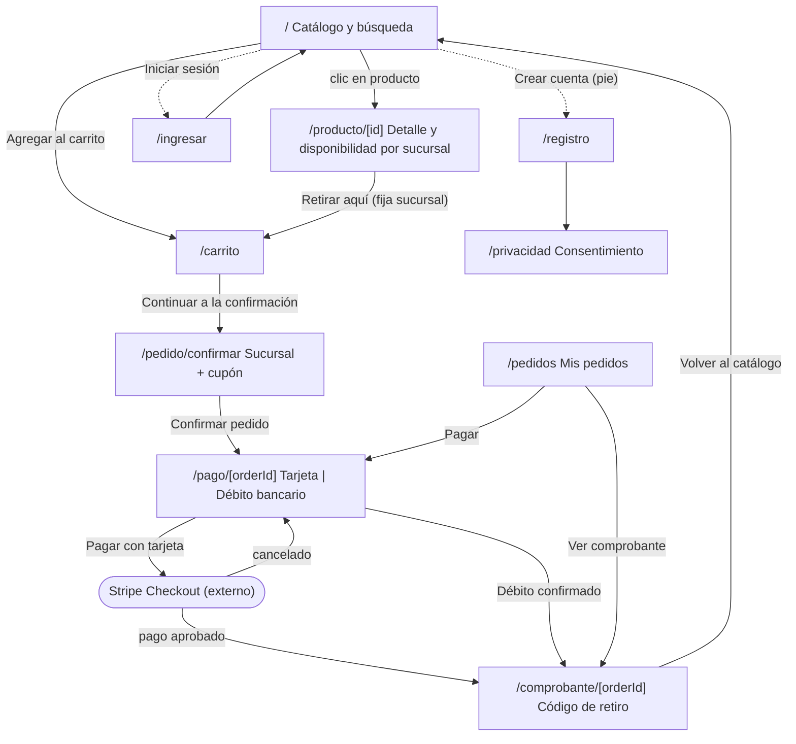

# 03 — Flujo del Caso de Uso 2 y excepciones

Todo lo de este archivo proviene de ejecutar el portal local (capturas en [02-estado-actual](02-estado-actual/inventario.md)) y de leer el código fuente. Los mensajes están copiados literalmente. Los números de captura (`NN`) son los de la carpeta `1440/` y `390/`.

## 1. Mapa de navegación

Cabecera de tienda (`ShopHeader`): aparece en catálogo, detalle, carrito y mis pedidos. **No** aparece en confirmación del pedido, pago ni comprobante, que usan un encabezado propio con solo el logotipo. Desde esas tres pantallas la única salida es el logotipo o, en el comprobante, "Volver al catálogo".

Contra el criterio "ruta clara de vuelta al inicio desde cualquier módulo": el logotipo lleva a `/` en todas las pantallas, pero no hay enlace "Volver al carrito" en confirmación ni "Cancelar" en pago.

## 2. Excepciones del caso de uso: qué ve hoy el usuario

### 2.1 Producto no publicado
- **Ruta:** `/producto/3` (producto con `published = false`). Capturas `10-producto-no-publicado`.
- **Qué pasa:** el servidor responde `404` con "El producto no existe o no está publicado en el canal", pero la pantalla **no lo muestra**: queda sin nombre ni precio, con el placeholder de imagen y la tabla de sucursales completa (la consulta de disponibilidad no valida la publicación).
- **Mensaje en pantalla:** ninguno propio. Solo el aviso permanente: "Una sucursal con más de 15 minutos sin sincronizar con el ERP no puede ofrecer retiro (RN-04). Las unidades disponibles publicadas ya descuentan el umbral de seguridad y las reservas de otros pedidos (RN-03)."
- **Si se pulsa "Retirar aquí":** el servidor responde `404` con "El producto no existe o no está publicado en el canal" (verificado con una llamada directa) y la pantalla lo mostraría en el aviso rojo.
- Producto inexistente (`/producto/9999999`, captura `11`): igual, pantalla vacía sin mensaje.

### 2.2 Carrito vacío
- **Ruta:** `/carrito`, captura `13-carrito-vacio-invitado`.
- **Mensaje:** "El carrito está vacío." Botón "Continuar a la confirmación" deshabilitado. Sin enlace para volver al catálogo en el cuerpo de la página.
- El mensaje del servidor "El carrito está vacío, no hay nada que confirmar" solo se vería si se confirma con el carrito vaciado en otra pestaña; el botón de confirmar también se deshabilita cuando no hay productos.

### 2.3 Unidades insuficientes
- **Ruta:** `/pedido/confirmar`, captura `26-confirmar-error-unidades-insuficientes` (cantidad 9999 en el carrito).
- **Mensaje (aviso rojo bajo el cupón):** "Solo hay 136 unidades disponibles para el producto 209 en la sucursal 6". Muestra identificadores internos (número de producto y de sucursal), no nombres.
- Variante de carrera: "Las unidades disponibles cambiaron antes de completar la reserva; vuelve a intentarlo" (texto del servidor, mismo aviso).

### 2.4 Sucursal desincronizada
- **En el detalle de producto** (captura `07`): cada sucursal muestra una insignia roja "Sin sincronizar hace N min" y "Retirar aquí" queda deshabilitado (atenuado, sin explicar por qué en el botón). Se muestra como "Sucursal #N", no por nombre.
- **En confirmar pedido** (captura `27-confirmar-error-sucursal-desincronizada`): el selector lista **todas** las sucursales, también las sin sincronizar. Al confirmar, aviso rojo: "La sucursal 3 lleva más de 15 minutos sin sincronizar con el ERP y no ofrece retiro".

### 2.5 Cupón inválido
- **Ruta:** `/pedido/confirmar`, capturas `28` y `29`.
- Al pulsar "Aplicar" con cualquier código aparece, sin validar, el aviso verde: "Cupón aplicado al confirmar (se valida en el servidor)".
- Al pulsar "Confirmar pedido" con un código inventado: aviso rojo "El cupón de lealtad no existe o no está vigente". El aviso verde anterior sigue visible al mismo tiempo (contradicción en pantalla). Las unidades reservadas se liberan (comportamiento del servidor).
- Con un cupón válido (captura `30`) no se muestra descuento en el resumen de la confirmación; el descuento solo se ve en el total del comprobante.
- Texto fijo siempre visible: "Un cupón se redime una sola vez por pedido, incluso si reintentas la confirmación (RN-07)."

### 2.6 Pago con tarjeta fallido
- **Pantalla de pago** `/pago/[orderId]`, pestaña Tarjeta (captura `31`): "Pagar con tarjeta" redirige a Stripe Checkout (externo, no capturado).
- **Regreso cancelado o fallido** (captura `37-pago-tarjeta-cancelado`): aviso rojo "El pago con tarjeta fue cancelado o no se completó."
- **Reintento sobre un pedido que ya no admite pago** (captura `36`): "El pedido ya no admite un nuevo intento de pago".
- Si el pago queda sin completar, el sistema marca el pedido como "Pago fallido" a los 15 minutos (código `liberarPagosVencidos`); en "Mis pedidos" se ve la etiqueta "Pago fallido" con el botón "Pagar".

### 2.7 Débito sin confirmar en 30 minutos
- **Mientras se espera** (captura `33-pago-debito-esperando`): aviso amarillo "Esperando confirmación del débito bancario…". Sin cuenta regresiva, sin hora límite, sin recarga automática.
- **Aviso previo** (captura `32`): "Se simula la confirmación del banco (no hay una pasarela de débito bancario real conectada). Si no hay confirmación en 30 minutos, el pedido se cancela."
- **Al vencer los 30 minutos:** un proceso del servidor cancela el pedido y libera la reserva. La pantalla de pago **no cambia** por sí sola; el usuario solo lo ve en "Mis pedidos" como "Cancelado", sin motivo ni acción siguiente.
- **Rechazo del banco:** el texto previsto es "El banco rechazó el débito (E-2). El pedido se canceló y la reserva se liberó." (aparece solo si la notificación se procesa).
- **Los botones "Simular confirmación" y "Simular rechazo" fallan hoy** (captura `34-pago-debito-simular-falla`): aviso rojo "Encabezado X-Debito-Secreto ausente o inválido". El frontend no envía ese encabezado. El débito solo se completa si la notificación llega por otra vía.

### 2.8 Pedido de otro cliente (403)
- **Ruta:** `/comprobante/13` abierta con la sesión de otro cliente (captura `41-comprobante-pedido-de-otro-cliente-403`).
- El servidor responde `403` con "Este pedido no pertenece al cliente autenticado", pero la pantalla ignora el mensaje: muestra "Confirmando el pago con la pasarela…" durante unos 30 segundos y termina con "El pago aún no se ha confirmado. Si acabas de pagar con tarjeta, espera unos segundos y recarga." El mensaje es engañoso para este caso.

### 2.9 Comprobante no disponible
- **Ruta:** `/comprobante/15` (pedido sin pagar), capturas `39` (reintentando) y `40` (final).
- El servidor responde `400` con "El comprobante no está disponible hasta que el pago quede confirmado".
- En pantalla: durante unos 30 segundos "Confirmando el pago con la pasarela…" y después "El pago aún no se ha confirmado. Si acabas de pagar con tarjeta, espera unos segundos y recarga." Sin botón para reintentar ni enlace a "Mis pedidos".

### 2.10 Firma o secreto inválido
Excepciones de sistemas externos (Stripe y banco simulado). **No tienen pantalla**; el cliente nunca las ve directamente. Respuestas literales del servidor (archivo [respuestas-api.json](02-estado-actual/respuestas-api.json)):

| Caso | Estado | Mensaje |
|---|---|---|
| Firma de webhook de Stripe inválida | 400 | "Firma de webhook inválida: No signatures found matching the expected signature for payload. Are you passing the raw request body you received from Stripe? …" |
| Secreto de notificación de débito incorrecto | 401 | "Encabezado X-Debito-Secreto ausente o inválido" |
| Secreto de notificación de débito ausente | 401 | "Encabezado X-Debito-Secreto ausente o inválido" |

Consecuencia visible para el cliente: el pago no se confirma, y queda en las pantallas de espera descritas en 2.7 y 2.9. Lo que el diseño debe contemplar es el estado "pago sin confirmar" con salida clara, no estos mensajes técnicos.

## 3. Otros estados observados

| Estado | Ruta | Captura | Texto literal |
|---|---|---|---|
| Búsqueda de menos de 3 caracteres | `/?q=ab` | `03` | "La búsqueda requiere al menos 3 caracteres" |
| Búsqueda sin resultados | `/?q=zzzzqqq` | `02` | "No hay productos publicados que coincidan." |
| Catálogo cargando | `/` | `05` | Sin indicador (solo "Cargar más" cambia a "Cargando…" cuando ya hay productos) |
| Fallo de red en el catálogo | `/` | `06` | "No se pudo cargar el catálogo" |
| Fallo al consultar disponibilidad | `/producto/[id]` | `12` | "No se pudo consultar la disponibilidad" |
| Producto agregado | `/producto/[id]` | `15` | "Producto agregado al carrito para retirar en esta sucursal." + botón "Ver carrito" |
| Carrito cargando | `/carrito` | `14` | "Cargando…" sin cromo de tienda |
| Documento ya registrado | `/registro` | `18` | "Ya existe una cuenta registrada con ese documento" |
| Credenciales inválidas | `/ingresar` | `20` | "Credenciales inválidas" |
| Mis pedidos sin sesión | `/pedidos` | `21` | "Unauthorized" |
| Mis pedidos vacío | `/pedidos` | `22` | "Todavía no tienes pedidos." |
| Comprobante emitido | `/comprobante/[id]` | `35` | "Pago confirmado" + código de retiro |
